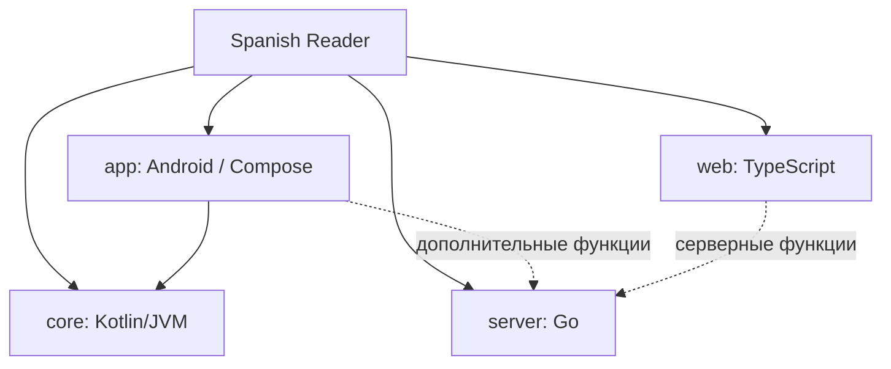
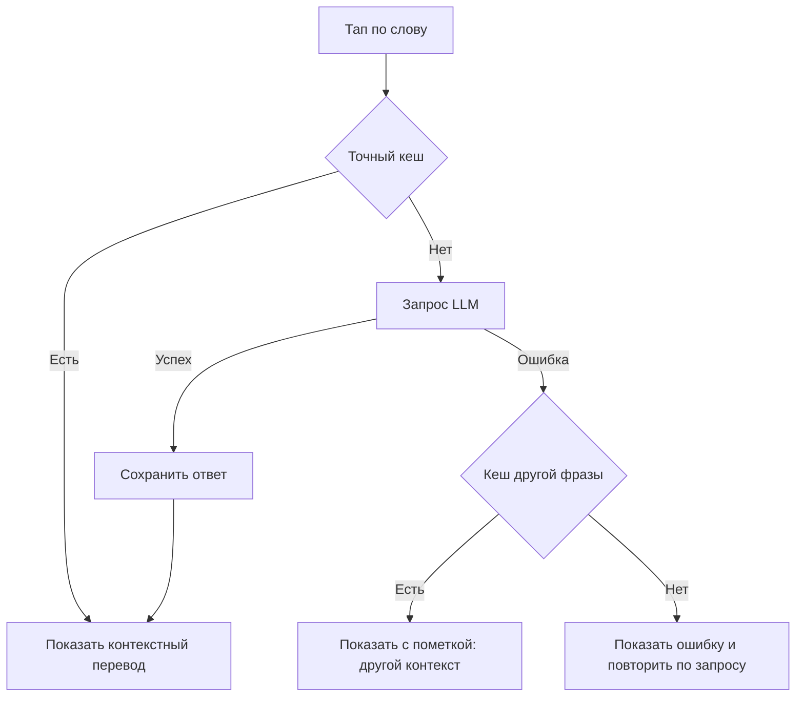
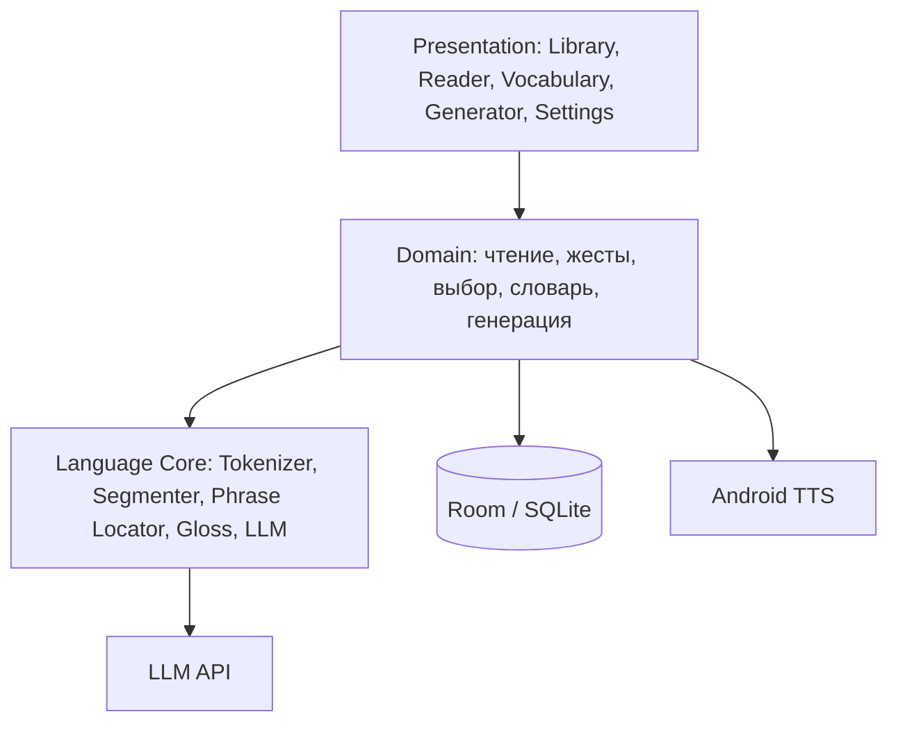

# Spanish Reader — технический аудит репозитория

**Дата:** 26 ноября 2026 г.  
**Версия документа:** 1.0  
**Исходный проект:** [awkay/spanish-reader](https://github.com/awkay/spanish-reader)  
**Исследованная ветка:** `main`  
**SHA дерева файлов, полученного при аудите:** `78de2b613e4145bb8104548ddf42b4f4555a75f5` (SHA дерева, не идентификатор коммита).  
**Лицензия:** MIT, Copyright (c) 2026 Tony Kay.  
**Метод:** статический архитектурный анализ дерева репозитория, конфигурации сборки и выбранных исходных файлов. Сборка, выполнение тестов, запуск APK и живые запросы к LLM не проводились.

## 0. Резюме и предлагаемые решения

Spanish Reader имеет отдельное языковое ядро Kotlin/JVM, независимое от Android SDK и Jetpack Compose. Это позволяет использовать его в собственном нативном Android-приложении без переноса на React или TypeScript.

Рекомендуемый подход — создать новый Kotlin + Jetpack Compose проект и выборочно перенести компоненты Spanish Reader вместе с соответствующими тестами. Полный форк возможен, но потребует удаления лишних функций и переработки существующей продуктовой логики.

| Категория | Результат аудита |
|---|---|
| Переиспользовать | Токенизацию, сегментацию предложений, поиск выражений, базовую инфраструктуру LLM, структуры языкового анализа и соответствующие тесты |
| Адаптировать | Промпты, грамматические модели, кеш, импорт, озвучивание, предварительную обработку и работу со словоформами |
| Написать заново | Экранные компоненты, жесты, правила подсветки и словаря, персонализированный генератор текстов |
| Не переносить в MVP | Go-сервер, веб-клиент, голосовой чат, YouTube, семейную синхронизацию, дополнительные тренажёры |

**Статус:** рекомендация по итогам статического аудита, а не утверждённая реализация. Все кандидаты на перенос должны пройти проверку исходников и тестирование в новом проекте.

## 1. Фактическая архитектура



| Компонент | Технология | Назначение |
|---|---|---|
| `core/` | Kotlin/JVM, Java 17 | Языковая обработка, LLM, кеш, общая логика |
| `app/` | Kotlin, Jetpack Compose | Android UI, Room, ViewModel, импорт, аудио |
| `server/` | Go | Дополнительные серверные функции |
| `web/` | TypeScript | Веб-клиент |

В `settings.gradle.kts` Android-сборка включает `:core` и `:app`. Модуль `:core` использует Kotlin JVM и Serialization, ориентирован на Java 17 и объявляет три основные внешние зависимости: Kotlin Coroutines, Kotlin Serialization JSON и OkHttp. У него нет зависимости от Android SDK. Модуль `:app` зависит от `:core`.

Разделение языкового ядра и интерфейса — существенное преимущество. При этом часть продуктовой логики находится в `core/vocab/`, а реализация кеша и сервисы на уровне приложения находятся в `app/`. Следовательно, весь `core` нельзя переносить без проверки только потому, что он не зависит от Android.

**Источники:** [settings.gradle.kts](https://github.com/awkay/spanish-reader/blob/main/settings.gradle.kts), [core/build.gradle.kts](https://github.com/awkay/spanish-reader/blob/main/core/build.gradle.kts), [app/build.gradle.kts](https://github.com/awkay/spanish-reader/blob/main/app/build.gradle.kts).

## 2. Матрица переиспользования

«Оставить» — кандидат на перенос без функциональных изменений, а не гарантия корректности или результат пройденных тестов. «Проверить» — в ходе аудита получено недостаточно данных для уверенного вывода о переносе без изменений.

| Файл / компонент | Решение | Назначение и замечания |
|---|---|---|
| `core/text/Tokenizer.kt` | Оставить | Разбиение текста на слова, пробелы, знаки препинания |
| `core/text/Token.kt` | Оставить | Позиции слов в исходном тексте |
| `core/text/SentenceSegmenter.kt` | Оставить | Границы предложений |
| `core/text/PhraseLocator.kt` | Оставить | Поиск выражений по токенам; проверить неоднозначные совпадения |
| `core/text/TextDecoding.kt` | Проверить | Декодирование импортируемых файлов |
| `core/text/ImportCleaner.kt` | Адаптировать | Очистка текста; не разрушать абзацы и разметку при импорте |
| `core/text/Paginator.kt` | Адаптировать | Страницы фиксированного объёма; проверить сохранение позиции при изменении настроек |
| `core/gloss/Gloss.kt` | Адаптировать | Модель структурированного языкового анализа |
| `core/gloss/GlossParser.kt` | Проверить | Разбор ответов LLM |
| `core/gloss/GlossPrompt.kt` | Переработать | Русскоязычные объяснения, структурированные грамматические поля |
| `core/gloss/GlosserFactory.kt` | Оставить как основу | Конфигурация и создание LLM-провайдеров |
| `core/gloss/OpenAiCompatibleGlosser.kt` | Оставить как основу | OpenAI-совместимый HTTP-клиент |
| `core/gloss/GlossCache.kt` | Адаптировать | Кеш с учётом языка и версии схемы/промпта |
| `core/vocab/VocabularyRules.kt` | Переписать | Правила изменения статуса слова |
| `core/vocab/WordStatus.kt` | Переписать | Статусы знания слова |
| `core/vocab/WordFamilies.kt` | Переработать | Наследование статуса словоформ и неоднозначность лемм |
| `core/vocab/LessonStats.kt` | Пересмотреть | Статистика не должна подразумевать знание всех прочитанных слов |
| `app/data/VocabRepository.kt` | Переписать полностью или частично | Явное управление изучаемой лексикой |
| `app/data/RoomGlossCache.kt` | Адаптировать | Постоянное хранение контекстного кеша |
| `app/data/LessonRepository.kt` | Адаптировать | Библиотека и прогресс чтения |
| `app/gloss/GlossService.kt` | Адаптировать | Кеш, запросы, ошибки, переводы по запросу |
| `app/ui/reader/ReaderScreen.kt` | Новый UI, перенос алгоритмов | Отрисовка текста, координаты слов, подсветка, прокрутка |
| `app/ui/reader/ReaderViewModel.kt` | Переписать | Координация новой логики чтения |
| `app/ui/reader/WordSheet.kt` | Новый UI | Два состояния карточки вместо одного |
| `app/ui/StatusColors.kt` | Переписать | Два функциональных цвета вместо многоуровневой раскраски |

Пути Kotlin в таблице сокращены: `core/src/main/kotlin/net/awkay/spanishreader/core/` и `app/src/main/kotlin/net/awkay/spanishreader/`.

### 2.1. Токенизация как основа интерактивного чтения

В `Token.kt` уже есть структура:

```kotlin
data class Token(
    val index: Int,
    val text: String,
    val kind: TokenKind,
    val start: Int,
    val normalized: String?,
    val sentenceIndex: Int,
)
```

Токены сохраняют смещения в исходном тексте, нормализованную форму и номер предложения. Это позволяет построить определение слова по тапу, выделение выражений, передачу контекста в LLM, подсветку, сохранение позиции чтения и синхронизацию с озвучиванием. Само распознавание жестов и преобразование экранных координат в токены остаются задачами интерфейса.

**Источники:** [Token.kt](https://github.com/awkay/spanish-reader/blob/main/core/src/main/kotlin/net/awkay/spanishreader/core/text/Token.kt), [Tokenizer.kt](https://github.com/awkay/spanish-reader/blob/main/core/src/main/kotlin/net/awkay/spanishreader/core/text/Tokenizer.kt), [SentenceSegmenter.kt](https://github.com/awkay/spanish-reader/blob/main/core/src/main/kotlin/net/awkay/spanishreader/core/text/SentenceSegmenter.kt), [PhraseLocator.kt](https://github.com/awkay/spanish-reader/blob/main/core/src/main/kotlin/net/awkay/spanishreader/core/text/PhraseLocator.kt).

## 3. Языковое ядро и грамматический анализ

В `Gloss.kt` определены структуры, которые содержат:

- Контекстный перевод, начальную форму, часть речи, другие значения.
- Время, наклонение, лицо и число глагола.
- Объяснение образования формы и причины выбора времени/наклонения.
- Клитики, их грамматические роли, референты и пояснения.
- Устойчивые выражения и их значение.
- Корни, этимологические и региональные пояснения.

Код содержит нормализацию ролей клитик, разделение присоединённых местоимений и исправление некоторых ошибок LLM при определении инфинитивов. Например, для `dáselo` можно визуализировать `dá` + `se` + `lo`, объяснить повелительное наклонение и замену `le` на `se` перед `lo`.

**Ограничение:** ядро не является полноценным самостоятельным морфологическим анализатором. Основные языковые выводы делает LLM. Kotlin-код формирует запросы, структурирует, нормализует и кеширует ответы. Наличие поля в модели не подтверждает точность его заполнения.

### 3.1. Русскоязычная локализация языкового анализа

`GlossPrompt.kt` содержит инструкции для англоязычного учащегося: `You are a Spanish tutor for an English-speaking learner of Latin American Spanish.` Английский жёстко задан и для переводов предложений.

Необходимо:

- Сделать язык объяснений и переводов параметром; по умолчанию русский.
- Сохранить ориентацию на латиноамериканский испанский.
- Сохранить машинно-читаемые идентификаторы грамматических ролей, частей речи, времени и наклонения; русские названия отображать отдельно.
- Адаптировать грамматические примеры и пояснения к уровню A2.
- Для визуального разбора расширить структуру ответа, где это требуется. Например, `formation` содержит текстовое объяснение, а не гарантированно структурированные основу, окончание и нерегулярную часть глагола.

**Источники:** [Gloss.kt](https://github.com/awkay/spanish-reader/blob/main/core/src/main/kotlin/net/awkay/spanishreader/core/gloss/Gloss.kt), [GlossPrompt.kt](https://github.com/awkay/spanish-reader/blob/main/core/src/main/kotlin/net/awkay/spanishreader/core/gloss/GlossPrompt.kt).

## 4. Интеграция с LLM

В ядре определены три интерфейса:

| Интерфейс | Назначение |
|---|---|
| `Glosser` | Контекстный анализ отдельных слов, в том числе пакетами |
| `SentenceAnalyzer` | Перевод предложений и поиск идиом |
| `TextCompleter` | Произвольные текстовые запросы к модели |

`TextCompleter` можно взять как основу персонализированной генерации учебных текстов.

`GlosserFactory` и `OpenAiCompatibleGlosser` предусматривают настраиваемые Base URL, ключ, название модели, лимит выходных токенов, JSON-ответы, основной и резервный провайдеры. На уровне сервиса реализован запрос улучшенного ответа другой моделью.

Для личного Android-приложения собственный сервер-прокси не является обязательным: клиент может обращаться непосредственно к OpenAI-совместимому API. Совместимость с выбранной моделью DeepSeek следует подтвердить живым запросом, включая формат JSON, таймауты и лимиты. Факт использования OpenAI-совместимого протокола сам по себе не подтверждает совместимость конкретной модели.

**Источники:** [GlosserFactory.kt](https://github.com/awkay/spanish-reader/blob/main/core/src/main/kotlin/net/awkay/spanishreader/core/gloss/GlosserFactory.kt), [OpenAiCompatibleGlosser.kt](https://github.com/awkay/spanish-reader/blob/main/core/src/main/kotlin/net/awkay/spanishreader/core/gloss/OpenAiCompatibleGlosser.kt), [GlossService.kt](https://github.com/awkay/spanish-reader/blob/main/app/src/main/kotlin/net/awkay/spanishreader/gloss/GlossService.kt).

## 5. Кеширование и локальное хранение

Текущий `GlossService` проверяет точный кеш перевода слова в предложении, при отсутствии результата обращается к LLM и сохраняет успешный ответ. Если запрос не удался, может показать кешированный перевод слова из другого контекста с признаком `fromOtherSentence`.



Существующий ключ словарного кеша состоит из нормализованной формы и хеша предложения. Поэтому `banco` в контексте скамейки и банка может иметь разные переводы. Room-база содержит DAO, репозитории и миграции.

### 5.1. Что необходимо исправить

1. Язык перевода отсутствует в ключе кеша. Русские и английские ответы могут конфликтовать.
2. Версия промпта и формата ответа отсутствует в ключе. После улучшения анализа могут сохраняться устаревшие ответы.
3. Перевод из другого контекста нельзя показывать как точный; сохранить маркировку и не использовать такой ответ как основание для автоматической идентификации значения.
4. Отделить кеш и историю запросов от активного словаря. Просмотр перевода не равен добавлению слова на изучение.

Предлагаемый состав ключа для словарного кеша: `form + sentenceHash + explanationLanguage + promptSchemaVersion`. Аналогичные правила применить к переводу предложения и данным поиска выражений. Это проектное предложение, а не описание реализованного кода.

**Источники:** [GlossCache.kt](https://github.com/awkay/spanish-reader/blob/main/core/src/main/kotlin/net/awkay/spanishreader/core/gloss/GlossCache.kt), [RoomGlossCache.kt](https://github.com/awkay/spanish-reader/blob/main/app/src/main/kotlin/net/awkay/spanishreader/data/RoomGlossCache.kt), [Entities.kt](https://github.com/awkay/spanish-reader/blob/main/app/src/main/kotlin/net/awkay/spanishreader/data/Entities.kt), [AppDatabase.kt](https://github.com/awkay/spanish-reader/blob/main/app/src/main/kotlin/net/awkay/spanishreader/data/AppDatabase.kt).

## 6. Продуктовая логика словаря: принципиальная несовместимость

### 6.1. Фактическое поведение оригинала

`VocabularyRules.onTap()` добавляет отсутствующее или новое слово в словарь со статусом `LEVEL_1` либо с наследуемым статусом словоформы. `ReaderViewModel.onWordTapped()` вызывает `app.vocab.tap()` для слов, не отмеченных как `KNOWN`; для ряда тапов также запускает перевод предложения.

`ReaderViewModel.onPageSettled()` при движении вперёд вызывает `finishPage()` для пройденных страниц. В результате оставшиеся новые слова тоже входят в словарь на первом уровне изучения либо с наследуемым статусом. `finishLesson()` выполняет аналогичную обработку последней страницы.

Это подтверждает, что нежелательная раскраска — не только визуальная проблема. Оригинальная бизнес-логика автоматически меняет состояние словаря при обычном чтении. Простое отключение синего цвета эту проблему не исправляет.

### 6.2. Наша ранее согласованная логика

| Состояние | Постоянная подсветка | Переход |
|---|---|---|
| Не отмечено | Нет | По умолчанию |
| Изучаю | Янтарная | Только явное добавление через `+` |
| Выучено | Нет | Только явная отметка `✓` |
| Фокус | Голубая, временная | Тап или выделение выражения |

Фокус — состояние UI, а не статус знания. Голубая подсветка имеет приоритет над янтарной. После закрытия карточки отображается постоянный статус. Снятие подсветки изучаемой лексики в режиме чистого чтения не меняет данные словаря.

Ни тап, ни перелистывание, ни завершение книги, ни предварительный перевод не должны добавлять слова в активную лексику или изменять статус изучения. История запросов и встреч может сохраняться отдельно. Количество запросов к переводу — сигнал интереса, но не доказательство незнания слова.

Требуется заменить `VocabularyRules.kt`, `WordStatus.kt`, переработать `VocabRepository.kt`, `WordFamilies.kt`, `LessonStats.kt` и соответствующие тесты.

### 6.3. Словоформы, омонимы, выражения

В существующей `VocabEntity` первичный ключ — нормализованное написание слова. `WordFamilies` группирует статусы по лемме, а `RoomGlossCache` может подбирать лемму из других контекстов.

Например, `vino` может быть существительным «вино» либо формой `venir` («пришёл»). Статус изучения одного значения не должен автоматически менять статус другого.

Предлагаемая модель должна различать словоформу, лемму, значение, контекст, тип единицы (слово или выражение) и статус изучения. Устойчивое выражение `darse cuenta de` должно быть самостоятельной единицей, а не только отдельными словами `dar` и `cuenta`.

Правила сопоставления значения и словоформы ещё предстоит разработать. При неоднозначности не следует автоматически переносить статус на все совпадения.

**Источники:** [VocabularyRules.kt](https://github.com/awkay/spanish-reader/blob/main/core/src/main/kotlin/net/awkay/spanishreader/core/vocab/VocabularyRules.kt), [WordStatus.kt](https://github.com/awkay/spanish-reader/blob/main/core/src/main/kotlin/net/awkay/spanishreader/core/vocab/WordStatus.kt), [WordFamilies.kt](https://github.com/awkay/spanish-reader/blob/main/core/src/main/kotlin/net/awkay/spanishreader/core/vocab/WordFamilies.kt), [VocabRepository.kt](https://github.com/awkay/spanish-reader/blob/main/app/src/main/kotlin/net/awkay/spanishreader/data/VocabRepository.kt), [ReaderViewModel.kt](https://github.com/awkay/spanish-reader/blob/main/app/src/main/kotlin/net/awkay/spanishreader/ui/reader/ReaderViewModel.kt).

## 7. Интерфейс и экранная логика: что написать заново

На момент проверки `ReaderScreen.kt` содержал 453 строки, `WordSheet.kt` — 433 строки, `ReaderViewModel.kt` — 411 строк. Размер файла сам по себе не является показателем качества, однако анализ показывает существенное отличие поведения от нашей концепции.

### 7.1. ReaderScreen и WordSheet

В исходном интерфейсе полезны следующие механизмы:

- `AnnotatedString` и токенные диапазоны для интерактивного текста.
- Определение координат слова с помощью `TextLayoutResult`.
- Отрисовка фонов и контура выбранного слова, подчёркивание выражений.
- Прокрутка до выделенного слова с учётом перекрытия нижней карточкой.
- Подсветка предложения при воспроизведении аудио.
- Переключение между словами без закрытия карточки.

Стоит заимствовать соответствующие алгоритмы, но экран и его поведение реализовать заново.

| Функция | Оригинал | Наша целевая реализация |
|---|---|---|
| Single Tap | Перевод и автоматическое изменение словаря для ряда статусов | Быстрая карточка, без изменения словаря |
| Double Tap | Не обнаружен в проверенном компоненте | Полная карточка |
| Long Press | Не обнаружен в проверенном компоненте | Выделение выражения или фразы |
| Свайп карточки вверх | Раскрытие не предусмотрено | Раскрытие полной карточки |
| Свайп карточки вниз | Закрытие | Сворачивание или закрытие |
| Карточка слова | Одна высота, половина области чтения | Быстрая и расширенная карточка |
| Повторный одиночный тап по слову в фокусе | Не подтверждено согласованное поведение | Закрытие карточки |
| Подсветка | Многоуровневая, новые слова синие | Только фокус и явно изучаемая лексика |
| Перевод предложения | В ряде случаев автоматически | По явному запросу |
| Добавление в словарь | Автоматическое и ручное | Только кнопка `+` |
| Завершение изучения | Несколько уровней статуса | Явная отметка `✓` |

При реализации Double Tap сохранить все ранее согласованные жесты. Первый тап должен открывать быструю карточку без искусственной задержки; второй тап в пределах интервала распознавания двойного нажатия раскрывает её вместо закрытия. Не запускать повторный запрос перевода при раскрытии. Проверить на реальном устройстве конфликт с повторным одиночным тапом, прокруткой и Long Press.

Система чтения должна оставаться полностью функциональной без ведения словаря. Обычное слово не выделяется; временный голубой фокус имеет приоритет над постоянной янтарной подсветкой. Конкретные оттенки и размеры карточек не утверждены окончательно.

### 7.2. ReaderViewModel

Существующий `ReaderViewModel` получает зависимости через `SpanishReaderApp`, координирует загрузку текста, пагинацию, словарь, LLM-запросы, предварительную обработку и аудио. В нём уже предусмотрена отмена предыдущего задания перевода и проверка текущего токена перед обновлением UI; эти приёмы полезно сохранить.

Предлагается разделить состояния и сузить зависимости ViewModel до необходимых интерфейсов, не создавая без необходимости отдельный ViewModel на каждое состояние.

| Состояние | Ответственность |
|---|---|
| `ReaderState` | Документ, позиция чтения, типографика, тема |
| `SelectionState` | Токен, выражение или предложение в фокусе |
| `CardState` | Закрыта / быстрая / полная карточка |
| `LookupState` | Загрузка, результат, грамматика, ошибка, источник перевода |
| `VocabularyState` | Активная и выученная лексика |
| `AudioState` | Озвучивание и позиция воспроизведения |

Это предлагаемая структура, не описание уже существующего кода.

**Источники:** [ReaderScreen.kt](https://github.com/awkay/spanish-reader/blob/main/app/src/main/kotlin/net/awkay/spanishreader/ui/reader/ReaderScreen.kt), [WordSheet.kt](https://github.com/awkay/spanish-reader/blob/main/app/src/main/kotlin/net/awkay/spanishreader/ui/reader/WordSheet.kt), [ReaderViewModel.kt](https://github.com/awkay/spanish-reader/blob/main/app/src/main/kotlin/net/awkay/spanishreader/ui/reader/ReaderViewModel.kt), [StatusColors.kt](https://github.com/awkay/spanish-reader/blob/main/app/src/main/kotlin/net/awkay/spanishreader/ui/StatusColors.kt).

## 8. Функции и зависимости, которые не нужны в MVP

| Компонент оригинала | Рекомендация |
|---|---|
| `server/` — сервер Go | Исключить из MVP |
| `web/` — веб-клиент | Исключить из MVP |
| `chat/` — текстовый и голосовой чат | Отложить |
| `drill/` — тренажёр спряжений | Отложить |
| `phrases/`, `practice/` — упражнения | Отложить; не путать с `core/text/PhraseLocator` и анализом выражений в читалке |
| `share/SyncService` — синхронизация | Отложить |
| `SharedLibraryScreen` — общая библиотека | Исключить |
| `share/YouTubeAudio.kt` | Исключить |
| Серверный OCR фотографий | Отложить |
| Серверное распознавание речи | Исключить |
| Google Cloud TTS | Необязательная интеграция |
| Локальное резервное копирование | Сохранить возможность, адаптировать к новой схеме |

Удаление серверных функций требует проверки вызывающего их кода. Например, `ImportViewModel` содержит импорт фото и YouTube через `WebShareService`, а `SpanishReaderApp` создаёт сервисы синхронизации, упражнений и общего доступа. Эти связи не следует переносить в новый проект без необходимости.

### 8.1. Gradle-зависимости

| Зависимость | Решение | Причина |
|---|---|---|
| Jetpack Compose | Оставить | Нативный интерфейс |
| Material 3 | Оставить | Базовые компоненты Compose |
| Room / SQLite, KSP | Оставить | Локальные данные |
| OkHttp | Оставить | Сетевые запросы |
| Kotlin Coroutines | Оставить | Асинхронность |
| Kotlin Serialization | Оставить | JSON и модели данных |
| Navigation Compose | Оставить | Навигация |
| DataStore | Оставить | Настройки, но не открытое хранение ключей |
| WorkManager | Опционально | Для фоновой предварительной обработки |
| Media3 ExoPlayer | Опционально | Полноценное аудиовоспроизведение |
| Media3 Session | Опционально | Фоновое воспроизведение и медиаконтролы |
| NewPipe Extractor | Не переносить | Зависимость YouTube-функционала |
| JitPack Repository | Не переносить после исключения NewPipe | Подключён для зависимостей NewPipe |
| Core library desugaring (`desugar_jdk_libs_nio`) | Перепроверить | В оригинале включён в связи с NewPipe; исключать только после проверки оставшихся API и minSdk |
| JUnit, Coroutines Test, MockWebServer, Room Testing, Compose UI Test, Robolectric | Сохранять по необходимости | Автоматические тесты переносимых компонентов и нового интерфейса |

Для произношения отдельных слов можно использовать Android TTS без собственного сервера и без обязательного Media3. Если нужно непрерывное чтение с аудио в фоне, Media3 следует оценить отдельно.

**Источники:** [app/build.gradle.kts](https://github.com/awkay/spanish-reader/blob/main/app/build.gradle.kts), [settings.gradle.kts](https://github.com/awkay/spanish-reader/blob/main/settings.gradle.kts), [SpanishReaderApp.kt](https://github.com/awkay/spanish-reader/blob/main/app/src/main/kotlin/net/awkay/spanishreader/SpanishReaderApp.kt), [ImportViewModel.kt](https://github.com/awkay/spanish-reader/blob/main/app/src/main/kotlin/net/awkay/spanishreader/ui/importer/ImportViewModel.kt).

## 9. Предварительная обработка текстов

В оригинале существуют `PreGlossPlanner.kt`, `PreGlossWorker.kt`, `PreGlossProgress.kt`. Worker использует WorkManager, выбирает окна страниц и слова с учётом существующих статусов, фильтрует кешированные запросы, отправляет оставшиеся запросы пакетами и публикует прогресс. Есть также предварительный анализ предложений и получение кеша с общего сервера при соответствующей настройке.

В `AppSettings` предварительный анализ по умолчанию включён, окно составляет три страницы. `ReaderViewModel.preGlossAround()` инициирует обработку следующих страниц во время чтения.

| Стратегия | Преимущество | Недостаток |
|---|---|---|
| Только по запросу | Минимальный расход токенов, простота MVP | Задержка при первом переводе, нужен интернет для некешированных данных |
| Выборочная предварительная обработка | Снижение задержек для выбранного фрагмента | Требуются правила отбора, бюджет и управление заданиями |
| Полная предварительная обработка | Возможность мгновенного офлайн-доступа к заранее подготовленным результатам | Анализ множества уже знакомых слов, больший расход токенов |

Рекомендация для MVP: перевод по запросу. Пакетный механизм сохранить как потенциальную наработку для будущей опции предварительного анализа, но изменить правила отбора и убрать зависимость от серверной синхронизации. Предварительная обработка не должна менять статусы слов и не должна автоматически раскрашивать текст. Не считать, что все слова без статуса неизвестны пользователю.

**Открытый вопрос:** окончательная политика предварительной обработки не утверждена пользователем. Расход токенов и задержки не измерялись.

**Источники:** [PreGlossPlanner.kt](https://github.com/awkay/spanish-reader/blob/main/core/src/main/kotlin/net/awkay/spanishreader/core/gloss/PreGlossPlanner.kt), [PreGlossWorker.kt](https://github.com/awkay/spanish-reader/blob/main/app/src/main/kotlin/net/awkay/spanishreader/gloss/PreGlossWorker.kt), [SettingsRepository.kt](https://github.com/awkay/spanish-reader/blob/main/app/src/main/kotlin/net/awkay/spanishreader/data/SettingsRepository.kt).

## 10. Безопасность и технический долг

Обнаружены конкретные архитектурные риски. Это не доказательство утечки данных или эксплуатации уязвимости.

| Наблюдение в оригинале | Рекомендация |
|---|---|
| Debug-ключ подписи хранится в репозитории и применяется также для release | Создать собственный application ID и ключ подписи; не хранить приватный ключ и пароли в репозитории |
| API-ключи входят в JSON профилей, сохраняемый в Preferences DataStore | Хранить секреты в защищённом хранилище с использованием Android Keystore |
| `android:usesCleartextTraffic="true"` | По умолчанию запретить незашифрованный HTTP; исключения для локальных провайдеров — только при необходимости и осознанной настройке |
| `android:allowBackup="true"` | Настроить правила резервного копирования, исключить секреты |
| `RECORD_AUDIO` и компоненты импорта фото связаны с дополнительными функциями | Не включать разрешения и компоненты, которые не нужны новому MVP |
| ViewModel получает общий `SpanishReaderApp` | Передавать только необходимые зависимости через конструкторы/интерфейсы |
| Язык и версия промпта отсутствуют в ключе кеша | Изменить схему кеширования |
| Перевод предложения запускается автоматически при ряде тапов | Сделать явным действием |

**Источники:** [AndroidManifest.xml](https://github.com/awkay/spanish-reader/blob/main/app/src/main/AndroidManifest.xml), [app/build.gradle.kts](https://github.com/awkay/spanish-reader/blob/main/app/build.gradle.kts), [SettingsRepository.kt](https://github.com/awkay/spanish-reader/blob/main/app/src/main/kotlin/net/awkay/spanishreader/data/SettingsRepository.kt), [SpanishReaderApp.kt](https://github.com/awkay/spanish-reader/blob/main/app/src/main/kotlin/net/awkay/spanishreader/SpanishReaderApp.kt).

## 11. Оценка качества архитектуры и тестового покрытия

Качественные оценки основаны на статическом анализе выбранных файлов, а не на измерении метрик или результатах выполнения тестов.

| Область | Оценка | Обоснование |
|---|---|---|
| Модульность языкового ядра | Высокая | Независимый Kotlin/JVM-модуль |
| Расширяемость LLM-интеграции | Высокая | Интерфейсы, фабрики и несколько типов провайдеров |
| Организация хранения данных | Достаточная | Room, DAO, репозитории, миграции |
| Разделение бизнес-логики и UI | Средняя | Ядро отдельно, но экранные ViewModel координируют многочисленные сервисы |
| Соответствие нашему UX | Низкое | Противоположная логика статусов и автоматического пополнения словаря |
| Безопасность конфигурации | Требует доработки | Секреты, HTTP, ключ подписи |

В дереве репозитория обнаружены, в частности, `TokenizerTest`, `SentenceAndPageTest`, `TextDecodingTest`, `JsonParsingTest`, `RichGlossTest`, `GlosserHttpTest`, `PlannerAndFactoryTest`, `VocabularyTest`, `WordFamiliesTest`, `RoomGlossCacheTest`, `MigrationTest`, `GlossServiceTest`, `PreGlossWorkerTest`, `ReaderScreenshotTest`, `KnownWordSheetTest`, `SettingsProfilesTest`.

При переносе компонентов необходимо перенести соответствующие тесты; для изменённых правил словаря и UI — написать новые. Наличие тестовых файлов не подтверждает, что тесты проходят или покрывают все критические сценарии.

## 12. Форк целиком или новый проект

| Критерий | Полный форк | Новый Kotlin-проект с выборочным переносом |
|---|---|---|
| Первый рабочий запуск | Потенциально быстрее | Необходима начальная настройка |
| Контроль продуктовой архитектуры | Ограничен существующими связями | Высокий |
| Старые функции | Нужно удалять или отключать | Не переносятся |
| Словарь и статусы | Рефакторинг существующей модели | Новая модель с самого начала |
| Новый интерфейс | Замена и адаптация старых экранов | Реализация по нашей спецификации |
| Сопровождение | Наследуется часть технического долга | Возможно уменьшить объём лишней логики |
| Получение будущих исправлений upstream | Проще при малых изменениях | Потребуется выборочный перенос и отслеживание |

**Рекомендация:** новый проект с выборочным переносом исходников. Причина — наличие отдельного `:core` и фундаментальные различия в бизнес-логике словаря. Это решение следует проверить первым техническим прототипом: перенос минимального набора ядра и запуск его тестов. Если перенос потребует слишком много изменений, целесообразно пересмотреть выбор.

## 13. Предлагаемая архитектура нового приложения

Не использовать React, Vite, IndexedDB или PWA в качестве базовой архитектуры Android-приложения. Предлагаемый стек: Kotlin, Jetpack Compose, Room, Coroutines, Serialization, OkHttp, DataStore, Android TTS.



Схема концептуальная: кеш и адаптеры локальных данных могут находиться на границе `app` и `core`. Продуктовый слой определяет правила словаря и отображения; языковой слой не должен управлять подсветкой или статусами изучения.

### 13.1. Предлагаемая структура репозитория

```text
spanish-reader/
├── app/
│   ├── ui/
│   │   ├── reader/
│   │   ├── library/
│   │   ├── vocabulary/
│   │   ├── generator/
│   │   └── settings/
│   ├── domain/
│   ├── data/
│   └── audio/
├── core/
│   ├── text/
│   ├── gloss/
│   ├── grammar/
│   └── llm/
├── docs/
│   ├── SPEC.md
│   ├── ARCHITECTURE.md
│   ├── TECHNICAL_AUDIT.md
│   └── UPSTREAM.md
└── LICENSE
```

На старте достаточно двух Gradle-модулей, `:app` и `:core`. Папки в схеме сокращены для читаемости; в рабочем репозитории следует использовать стандартные Gradle source sets (`src/main/kotlin`, `src/test/kotlin` и т. п.).

### 13.2. Лицензия и отслеживание upstream

В оригинальном репозитории подтверждено наличие [MIT LICENSE](https://github.com/awkay/spanish-reader/blob/main/LICENSE) с copyright Tony Kay, 2026. Сохранить текст лицензии и уведомление об авторских правах во всех копиях или существенных частях заимствованного кода. В `UPSTREAM.md` фиксировать источник, точный commit SHA при фактическом клонировании, перечень перенесённых компонентов, изменения и соответствующие тесты.

Отдельно проверить лицензии сторонних зависимостей. Настоящий аудит не является полной проверкой лицензий и состава поставки.

## 14. Проверки перед началом разработки и критерии приёмки

Предлагаемая последовательность работ для кодингового агента; реализация в рамках аудита не выполнялась.

1. Клонировать оригинальный репозиторий и зафиксировать commit SHA. Собрать оригинальные `:core` и `:app`, выполнить тесты, записать фактическое состояние сборки и список зависимостей.
2. Создать чистый Kotlin + Jetpack Compose проект с отдельным application ID и собственной подписью. Перенести минимальные компоненты `core/text` и их тесты.
3. Перенести LLM-интерфейсы, парсер, клиент и тесты. Подготовить русскоязычный промпт и расширяемую схему грамматического анализа. Проверить реальный запрос к выбранному DeepSeek API.
4. Реализовать локальную модель документов, прогресса чтения, кеша, истории переводов и изучаемой лексики. Проверить разделение этих сущностей.
5. Реализовать читалку и карточки по согласованным UX-правилам. Заимствовать механизмы отрисовки и токенных диапазонов, где это оправдано.
6. Реализовать импорт собственного текста, библиотеку, настройки и генерацию учебных текстов согласно отдельной продуктовой спецификации.
7. Проверить отсутствие ненужных сервисов, разрешений, зависимостей и секретов в APK. Провести сборку и тестирование на физическом Android-устройстве.

Минимальный набор регрессионных сценариев:

- Новый текст не имеет постоянной подсветки, если в нём нет явно изучаемой лексики.
- Одиночный тап, двойной тап, перелистывание и закрытие документа не изменяют статусы изучения.
- `+` добавляет единицу в активный словарь, `✓` переводит её в выученную лексику.
- Временный фокус не изменяет постоянный статус и исчезает после закрытия карточки.
- Double Tap и повторный одиночный тап различаются; раскрытие не дублирует API-запрос.
- При быстрых последовательных тапах устаревшие сетевые ответы не заменяют результат текущего выделения.
- Перевод предложения запрашивается явно, а не автоматически при каждом тапе.
- Кеш различает контексты, язык объяснения и версию промпта; неконтекстный fallback явно маркируется.
- `vino` как существительное и форма `venir` не объединяются в одну изучаемую единицу без различения значений.
- Предварительная обработка (если включена) не добавляет слова в активный словарь.
- Импорт и чтение сохранённого текста работают без обязательного Go-сервера или веб-клиента.
- Резервное копирование и экспорт не раскрывают API-ключи.

## 15. Границы аудита и открытые вопросы

**Подтверждено:** получено полное дерево файлов репозитория; изучены ключевые исходники и Gradle-конфигурация; подтверждено наличие MIT-лицензии; установлена фактическая модульность и автоматическое изменение словарных статусов.

**Не подтверждено:** работоспособность всех файлов в текущей ветке, успешная сборка, прохождение тестов, производительность на телефоне, качество ответов LLM, полный граф транзитивных зависимостей, совместимость с конкретной моделью DeepSeek. Клонирование в среду исполнения не было выполнено из-за сетевого ограничения. Не все исходники были прочитаны полностью; выводы о кандидатах на перенос предварительные. Ссылки на `main` могут со временем указывать на изменившийся код.

**Решения, требующие согласования:** окончательная стратегия переноса (рекомендован новый проект); политика предварительного анализа (рекомендован on-demand); окончательная схема идентификации значений и словосочетаний; структура визуального грамматического разбора; необходимость фонового аудио и облачной озвучки; точная модель прогресса чтения и формат импорта.

Продуктовая спецификация в рамках этого аудита не редактировалась. Этот документ — самостоятельный технический материал для принятия решений и дальнейшей работы, а не замена `SPEC.md`.
